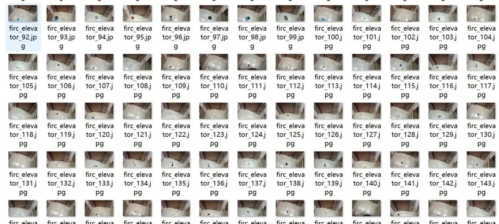
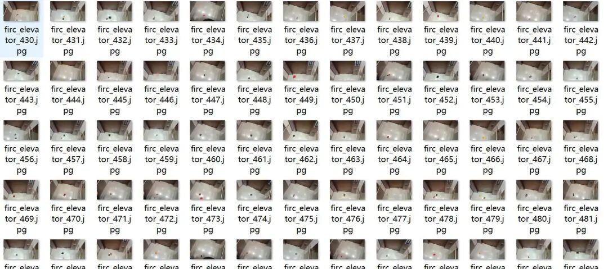
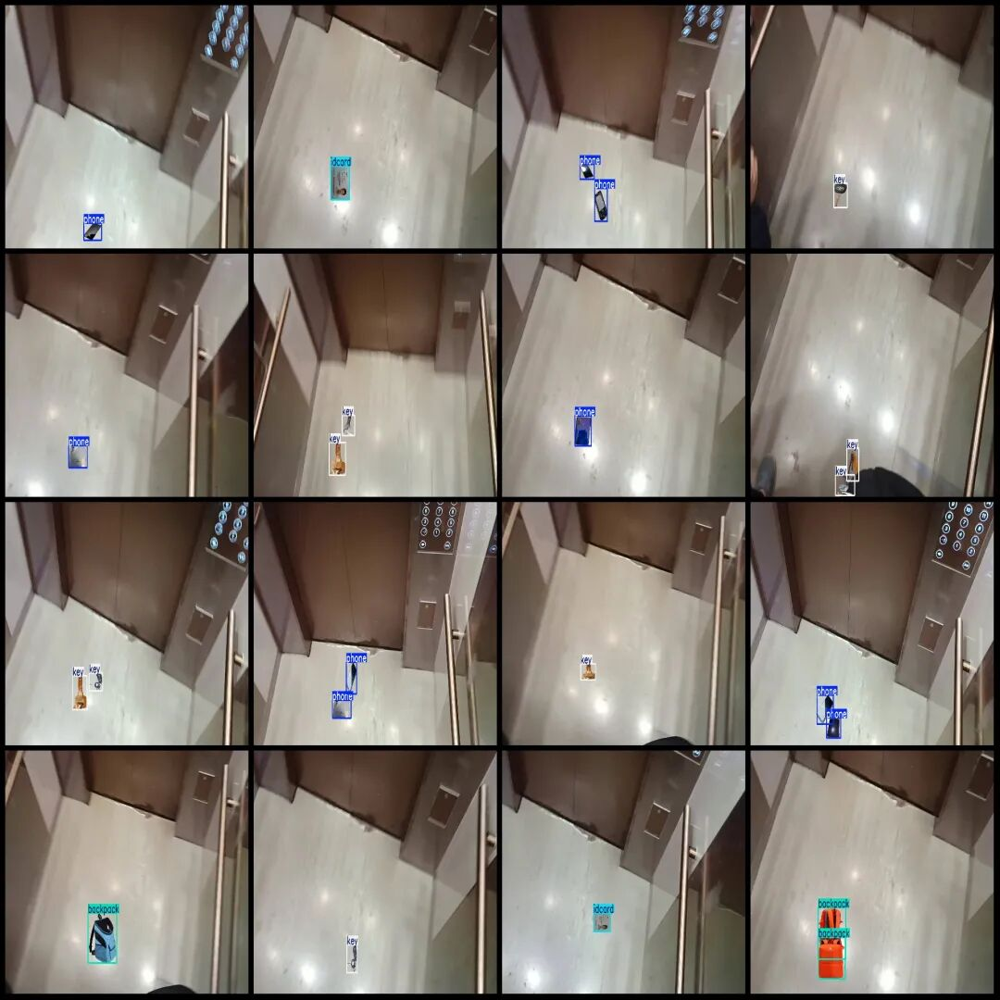
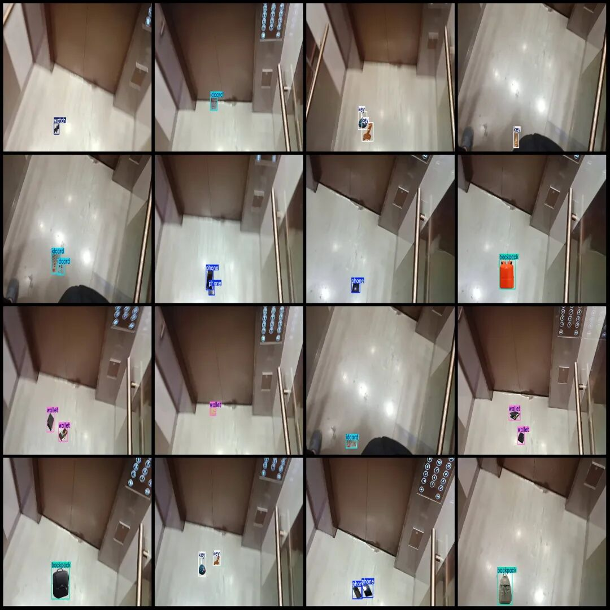

# Elevator Leftovers Detection Dataset VOC+YOLO format with 610 images and 6 categories

Dataset format: Pascal VOC format + YOLO format (txt file without split path, only containing jpg images and corresponding VOC format xml files and yolo format txt files)

Number of images (number of jpg files): 610

Number of annotations (number of xml files): 610

Number of annotations (number of txt files): 610

Label count: 6

Label category names (Note that the order of yolo format categories does not correspond to this, but is based on the classes.txt in the labels folder): ["backpack", "idcard", "key", "phone", "wallet", "watch"]

Number of boxes labeled in each category:

Backpack (Backpack) Frame Count = 143

ID card (ID card) frame count = 149

Key (key) frame count = 151

Phone (mobile phone) Frame Count = 167

Number of frames for wallet (wallet) = 144

Watch (watch) Frame Count = 152

Total frame count: 906

Image resolution: 1920x1080

Using labelImg:

Annotation rules: Draw a rectangle around the category.

Important Notice: No

Special : This dataset does not guarantee the accuracy of the trained models or weight files.

Image Preview:

Annotation example:

## Payment

Here is a pay link on Stripe ( https://buy.stripe.com/3cs8yP7sY87d0vu9AB ). Please contact me lonlonago@foxmail.com after funding $89, and I will send you a complete data files , thank you!

